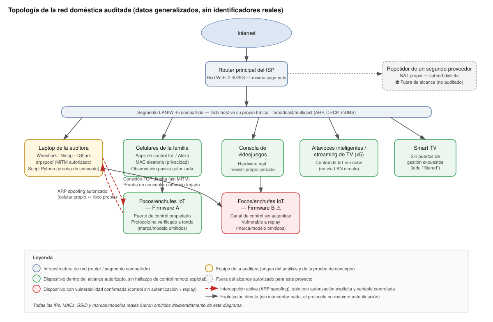

# Home Security Network Audit · Auditoría de Seguridad en Red Doméstica

> 🔒 **This is a sanitized, public version of an academic project.** All real IP addresses, MAC addresses, Wi-Fi network names (SSID) and hostnames were removed or replaced with generic placeholders. The exact brand/model of the vulnerable IoT device, and the complete working exploit, are deliberately not published — see [`exploit/README.md`](exploit/README.md).
>
> 🔒 **Esta es una versión pública y sanitizada de un proyecto académico.** Se eliminaron o sustituyeron por marcadores genéricos todas las direcciones IP y MAC reales, el nombre de la red Wi-Fi (SSID) y los nombres de host. La marca/modelo exacto del dispositivo IoT vulnerable y el exploit completo no se publican deliberadamente — ver [`exploit/README.md`](exploit/README.md).

---

## English

Academic security audit of a real home Wi-Fi network: asset discovery and classification (Nmap/Wireshark), authorized active interception (ARP spoofing) of an IoT device whose control protocol couldn't be identified by port fingerprinting alone, full reverse-engineering of that proprietary protocol, a working proof-of-concept exploit, and a concrete protocol-level mitigation.

**Core finding:** a smart bulb/plug exposes a TCP control channel with no real authentication and no replay protection. A hand-built packet, based on the reverse-engineered frame format, controls the device directly — no interception needed at attack time, and a packet captured once works forever.

### Contents

| | |
|---|---|
| 📄 [`en/01-audit-report.md`](en/01-audit-report.md) | Full audit report: objectives, environment, methodology summary, results per finding, severity analysis, conclusions |
| 🧭 [`en/02-methodology.md`](en/02-methodology.md) | Step-by-step methodology with commands, explained reasoning, and a reusable protocol reverse-engineering process |
| 🛡️ [`en/03-mitigations.md`](en/03-mitigations.md) | Protocol redesign (pre-shared key + HMAC + anti-replay) and general network hygiene recommendations |
| 📝 [`en/scope-and-authorization.md`](en/scope-and-authorization.md) | Summary of the written family consent that authorized this project |
| 🗺️ [`diagrams/network-diagram.svg`](diagrams/network-diagram.svg) | Generalized network topology diagram (no real identifiers) |
| 🖼️ [`screenshots/`](screenshots/) | Redacted Wireshark screenshots, referenced inline from the report |
| 🧩 [`exploit/`](exploit/) | Trimmed/redacted proof-of-concept code — see its README for exactly what was withheld and why |

### Why this ISN'T a full write-up of "how to hack a specific product"

The goal of publishing this project is methodology and learning, not providing a ready-made attack against a specific commercial product still in active use in homes. Read [`exploit/README.md`](exploit/README.md) for the full reasoning behind what was redacted.

---

## Español

Auditoría académica de seguridad sobre una red Wi-Fi doméstica real: descubrimiento y clasificación de activos (Nmap/Wireshark), interceptación activa autorizada (ARP spoofing) de un dispositivo IoT cuyo protocolo de control no pudo identificarse solo con fingerprinting de puertos, ingeniería inversa completa de ese protocolo propietario, una prueba de concepto funcional, y una mitigación concreta a nivel de protocolo.

**Hallazgo central:** un foco/enchufe inteligente expone un canal de control TCP sin autenticación real y sin protección contra repetición (replay). Un paquete armado a mano, con base en el formato de trama reconstruido por ingeniería inversa, controla el dispositivo directamente — sin necesidad de interceptar nada en el momento del ataque, y un paquete capturado una sola vez funciona para siempre.

### Contenido

| | |
|---|---|
| 📄 [`es/01-informe-auditoria.md`](es/01-informe-auditoria.md) | Informe completo de la auditoría: objetivos, entorno, resumen de metodología, resultados por hallazgo, análisis de severidad, conclusiones |
| 🧭 [`es/02-metodologia.md`](es/02-metodologia.md) | Metodología paso a paso con comandos, razonamiento explicado, y un proceso reutilizable de ingeniería inversa de protocolos |
| 🛡️ [`es/03-mitigaciones.md`](es/03-mitigaciones.md) | Rediseño del protocolo (llave pre-compartida + HMAC + anti-replay) y recomendaciones generales de higiene de red |
| 📝 [`es/alcance-y-autorizacion.md`](es/alcance-y-autorizacion.md) | Resumen del consentimiento familiar por escrito que autorizó este proyecto |
| 🗺️ [`diagrams/network-diagram.svg`](diagrams/network-diagram.svg) | Diagrama de topología de red generalizado (sin identificadores reales) |
| 🖼️ [`screenshots/`](screenshots/) | Capturas de Wireshark redactadas, referenciadas dentro del informe |
| 🧩 [`exploit/`](exploit/) | Código de prueba de concepto recortado/redactado — ver su README para el detalle de qué se omitió y por qué |

### Por qué esto NO es un instructivo de "cómo hackear un producto específico"

El objetivo de publicar este proyecto es la metodología y el aprendizaje, no entregar un ataque listo para usar contra un producto comercial específico todavía en uso activo en hogares. Ver [`exploit/README.md`](exploit/README.md) para el razonamiento completo detrás de lo que se redactó.

---

Author / Autora: Arely Muñoz
