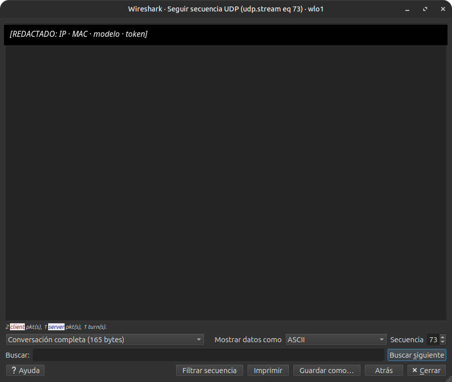
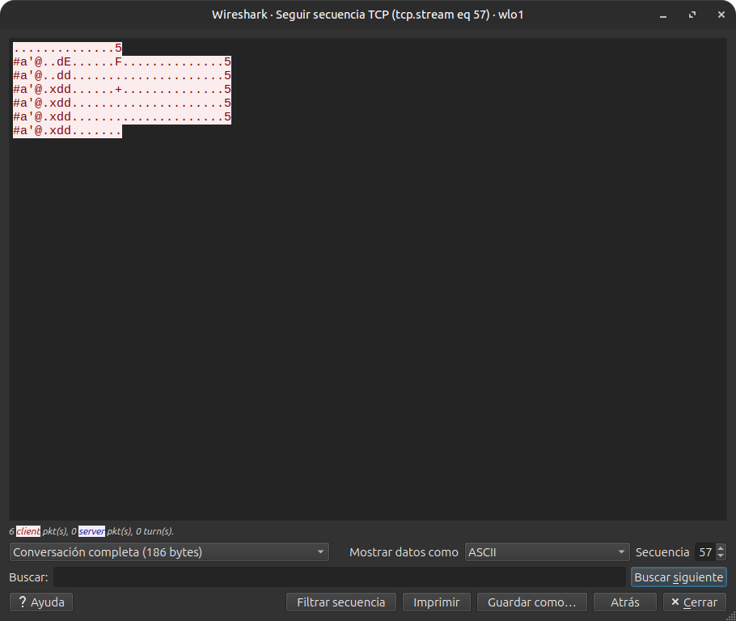
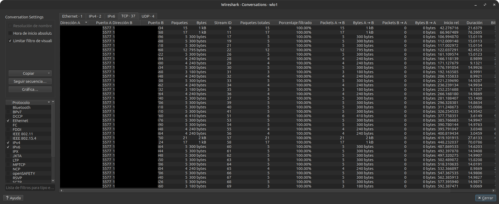
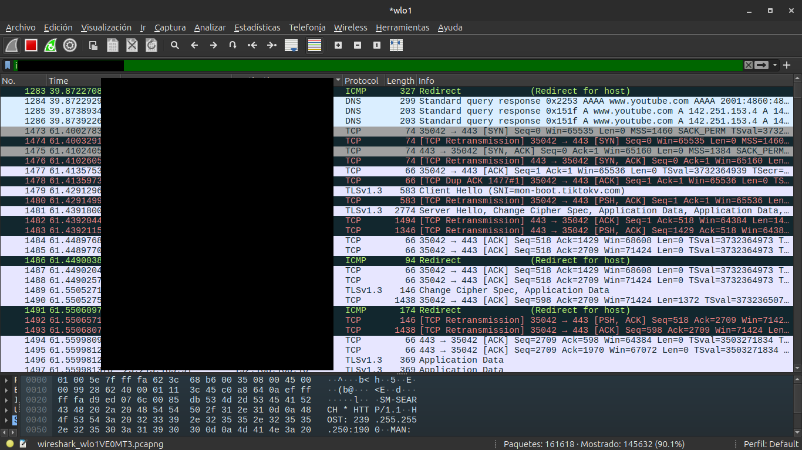
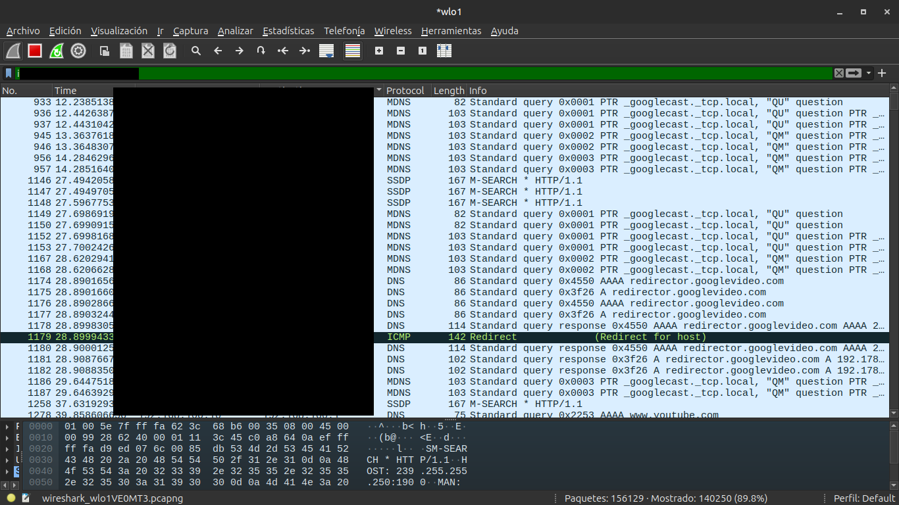
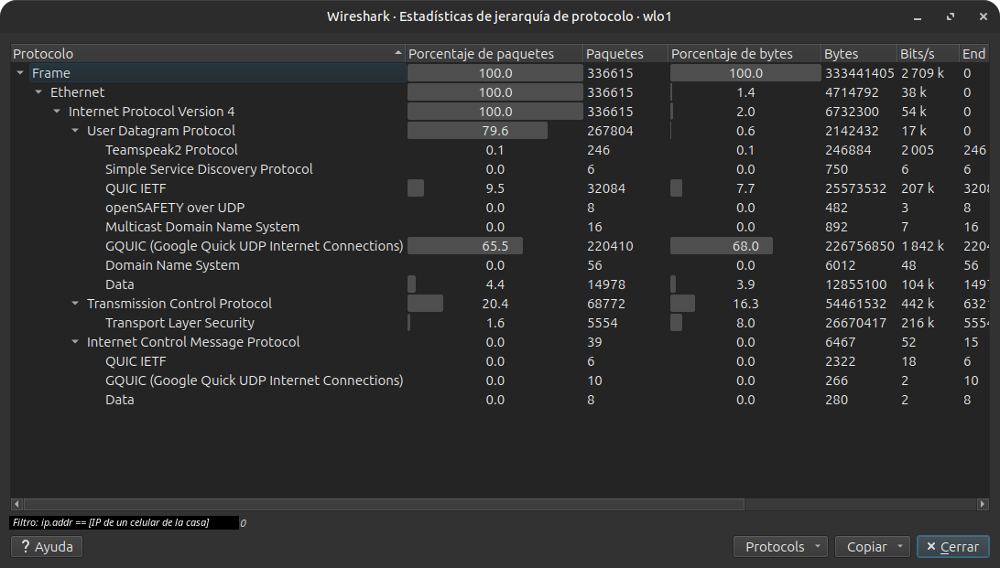

# Audit Report — Security Analysis of a Home Network

**Author:** Arely Muñoz, cybersecurity student
**Project type:** academic audit, authorized in writing by the owners of the audited devices
**Timeframe:** July–August 2026

> ⚠️ **Responsible disclosure note.** This report describes a real vulnerability found in a low-cost IoT device widely available on the market (a "generic" app-controlled smart bulb/plug). **The exact brand and model of the device are deliberately not published**, nor is the complete, working exploit code. See [`exploit/README.md`](../exploit/README.md) for details on what was omitted and why. All real IP addresses, MAC addresses, network names (SSID), and hostnames were removed or replaced with generic placeholders.

---

## 1. Executive summary

I audited my home Wi-Fi network as an academic project, with explicit, written family authorization (see [`scope-and-authorization.md`](./scope-and-authorization.md)). The initial goal was purely passive discovery: identify what devices exist on the network and whether any of them expose plaintext traffic. During execution, the scope grew — with authorization — to include active interception (ARP spoofing) when port scanning alone wasn't enough to identify an IoT device's protocol.

**Core finding:** a family of smart bulbs/plugs in the house exposes a control channel (TCP, "Magic Home"/`flux_led`-family port) with **no real authentication whatsoever** and **no protection against replay attacks**. I hand-built a valid packet using the protocol structure reconstructed through reverse engineering and sent it directly to the device, with no interception needed at attack time — the device obeyed. The same packet, captured once, can control the device indefinitely.

**Severity:** medium-high at the home-LAN level. It is not exploitable from the internet (the channel is local-only), but any device already present on the home Wi-Fi — including a guest, a compromised IoT device, or an attacker who already breached the Wi-Fi — can control the device without authorization, without knowing any password, and without leaving the trail that a sustained active interception attack would leave.

**No leaks were found** in encrypted (HTTPS/TLS) content from any device. As expected, metadata (domain queried via DNS, TLS SNI, connection volume and duration) remains visible even when content is encrypted.

---

## 2. Objectives

- Discover and classify active devices on the home network.
- Identify plaintext traffic and exposed metadata using standard command-line tools (Nmap, Wireshark, TShark).
- When port fingerprinting wasn't enough to identify an IoT device's protocol, authorizedly intercept its traffic (ARP spoofing) to reverse-engineer the protocol.
- Validate any finding with a reproducible proof of concept, not just speculation.
- Design a concrete mitigation based on the confirmed vulnerabilities.

## 3. Environment and scope

| Component | Detail |
|---|---|
| Auditor machine OS | Linux (host, no virtual machine) |
| Tools | Wireshark + `dumpcap` (using `cap_net_admin`/`cap_net_raw` capabilities, not running everything as `sudo`), Nmap, TShark, `arpspoof` (`dsniff` package), Python 3 (`socket`) |
| Audited network | Home's main Wi-Fi network (2.4GHz and 5GHz, same IPv4 /24 segment) |
| Out of scope | A secondary ISP repeater's subnet (its own NAT, a fully separate segment) — a conscious decision not to expand the project into that network |
| Third-party devices | With prior authorization, family members' traffic was also intercepted (not just the auditor's own), limited to metadata observation when the target wasn't the auditor's own equipment |

I stayed on the host OS (no VM) because ARP spoofing needs raw access to the Wi-Fi adapter, and bridged mode for a VM over a Wi-Fi adapter is notoriously unreliable due to limitations of the 802.11 standard itself, not misconfiguration.

## 4. Methodology (summary)

See the full step-by-step detail, with commands and reasoning, in [`02-methodology.md`](./02-methodology.md). In summary:

1. **Asset discovery** with `nmap -sn` across the full network range.
2. **Host classification** using the MAC address (vendor OUI + universal/local bit to distinguish factory MACs from privacy-randomized ones), not the IP (which changes via DHCP).
3. **Port fingerprinting** (`nmap -sS -sV -p-`) on hosts that couldn't be identified by MAC/vendor alone.
4. **Traffic capture** with Wireshark, filtering by protocol (HTTP, DNS, TLS/SNI, mDNS, ARP).
5. **Authorized active interception (ARP spoofing)** when port fingerprinting failed to identify an IoT device's protocol.
6. **Protocol reverse engineering**: frame format, fields, checksum formula.
7. **Proof of concept**: manually building a valid packet and sending it directly to the device, to confirm the finding is exploitable and not just theoretical.
8. **Mitigation design** based on the confirmed weaknesses.

## 5. Results and findings

### 5.1 Asset discovery and classification

The discovery scan (`nmap -sn`) across the full network returned between 19 and 20 active hosts across separate runs. Several devices changed IP between runs (DHCP), so I stopped using IP as an identifier and anchored to MAC instead.

To separate phones with randomized MACs (privacy randomization, standard on modern iOS/Android) from real factory hardware, I computed the **universal/local (U/L) bit**: the second least-significant bit of the MAC's first octet. If 1 → software-generated MAC (typical of a phone with randomization enabled). If 0 → real factory MAC, assigned by the manufacturer.

Resulting classification (generalized identifiers):

| Role | Approx. count | Classification |
|---|---|---|
| Main router/gateway | 1 | Infrastructure, not a target |
| Secondary ISP decoder/repeater | 1 | Confirmed, not a target |
| Game console | 1 | Confirmed (real factory hardware, own firewall closed to everything) |
| Smart speakers / TV streaming devices | 4 | Investigated, no exploitable finding (see below) |
| Smart TV | 1 | Investigated, no open ports |
| Smart bulbs/plugs | 7 (two distinct firmware families) | Main target — one family turned out to be vulnerable |
| Family phones | the rest | Ruled out (confirmed randomized MAC) |

### 5.2 Port fingerprinting — findings by category

**Secondary ISP decoder/repeater.** One port responded with an SDK banner typical of a chip family used in IP cameras, cheap DVRs, and cable TV decoders; another port responded with the standard certification banner for streaming platforms on smart TVs/set-top boxes. The port used by IP cameras (RTSP) **was not open**, which ruled out my initial hypothesis that it was a camera.

**Game console.** All 65,535 ports came back "filtered" (no response at all). Real factory MAC, no custom hostname in the router panel, intermittent connection pattern with no fixed human schedule — consistent with a device that powers off when not in use.

**Smart speakers / TV streaming devices.** All four devices showed the same pattern: two ports identified by Nmap as a passive server-monitoring protocol. I concluded this is almost certainly a **fingerprinting false positive**: that protocol assumes a server role receiving reports, while these devices are clients reporting to the manufacturer's cloud — the role doesn't match the device's actual function. A port flagged as an "unauthenticated" SOCKS5 proxy was also found on three of the four; I tested it by attempting real tunnels toward a generic domain and toward the manufacturer's own domain, and in both cases the service **actively and immediately rejected the connection** — not a functional open proxy, ruled out as an exploitable finding. One of the four devices was explicitly confirmed, via a direct Nmap fingerprint, as a streaming player from a well-known manufacturer.

**Smart TV.** No open ports, all 65,535 came back "filtered." My initial hypothesis ("bigger brands invest more in security") didn't hold up once compared against the smart speakers/streaming devices (from an even bigger manufacturer, with more exposed surface); what seems to matter is the kind of function the device needs to expose on the local network, not the size of the company. With only one smart TV in the sample, this observation also can't be generalized to the whole category.

**Smart bulbs/plugs.** Two distinct firmware families, each with its own control port. Nmap couldn't identify the real protocol behind either proprietary port — "unknown service" in both cases — which prompted a move to direct traffic inspection.

### 5.3 ARP spoofing: methodology and real execution problems

On a normal switch, a machine only sees its own unicast traffic plus whatever is broadcast/multicast (ARP, DHCP, mDNS). To see the conversation between a phone and a bulb (neither of which is my machine), I needed to place myself in the middle via ARP spoofing: poisoning the phone's ARP cache (impersonating the bulb) and the bulb's ARP cache (impersonating the phone), with IP forwarding enabled so as not to cut off traffic.

The first experiment used my own phone and my own bulb, to avoid risking anyone else's device while learning the tool. It didn't work on the first try, and documenting **why** it didn't turned out to be as valuable as the final result:

- **A typo in one IP** left one of the two attack directions unpoisoned — rather than a catastrophic failure, the result was a partial interception (only one direction of the conversation), confirming that the two ARP-poisoning instances are independent attacks, one per direction.
- **An `arpspoof` restoration bug**: stopping the attack with Ctrl+C in a certain state caused the tool to restore the victims' ARP cache pointing to an all-zeros MAC address instead of the real one, temporarily disconnecting the device. On a clean retry, restoration correctly used the real MAC.
- **Persistent one-way interception:** with both attack directions correctly configured, I captured 37 TCP conversations on the proprietary protocol's port, but **all 37 had data in only one direction** (device→phone, never phone→device). The initial hypothesis was that the phone refreshed its ARP cache faster than the attack could re-poison it.

That hypothesis fell apart in the next session: repeating the attack, the device's app flagged "no internet connection" for that device only. I ruled things out step by step, with evidence rather than intuition: voice control (cloud-based) kept working → the device never actually lost its real internet connection; a ping from the phone with the attack active had 0% loss → basic IP forwarding was working; a direct query to the device's discovery protocol (see §5.4) **got no response** with the attack active. Checking the capture, the packet did reach my machine, but my machine never forwarded it to the device.

**Root cause:** `sudo iptables -L FORWARD -n -v` revealed the `FORWARD` chain had a default **DROP** policy, with hundreds of packets already dropped there — a rule from the OS's own host firewall (enabled by default), with a single explicit exception for ping. This retroactively explains both the "no internet" symptom and the previous session's one-way interception: it was never the phone "winning a race" against the attack — it was my own firewall silently blocking that direction of traffic from the start. Fixed with an explicit rule allowing forwarding between devices on the same interface, without disabling the firewall entirely.

**Methodology lesson:** when doing local MITM from a daily-use machine (not a dedicated pentesting box), the attacker's own machine can have configuration that interferes with the attack without producing any visible error. It's worth auditing your own setup before assuming the problem is on the victim's side.

A side effect identified and mitigated: the machine, when forwarding a packet back out the same interface it arrived on, automatically generated ICMP Redirect packets — if the victim heeds them, it learns to bypass the attacker and the attack breaks. This kernel behavior was explicitly disabled for the interface in use.

### 5.4 Core finding: reverse-engineering the IoT device's control protocol



*The device responds to a fixed, publicly documented magic phrase over UDP with its IP, MAC, exact hardware model, and a hex token — all in plaintext. Real values were redacted for this publication.*

Before reaching the control channel, I found a discovery service (a UDP port of the protocol family) that responds to a **fixed query phrase, public and documented on the internet**, with the device's IP, MAC, exact hardware model, and a hex token — **all in plaintext, with no authentication whatsoever**. I confirmed ARP spoofing isn't even needed to get this response: any machine on the LAN that knows the phrase can request this information from any device of this family.

The real control channel is on a dedicated TCP port. With clean captures (firewall issue resolved), I reconstructed the full frame format by comparing packets of different sizes:

```
MAGIC (4 bytes) | TYPE (2 bytes) | COUNTER (2 bytes) | LENGTH (2 bytes) | DATA (LENGTH bytes) | CHECKSUM (1 byte)
```

- **MAGIC:** constant across 100% of captured packets, regardless of sender. It's a public protocol identifier, not a credential — it doesn't distinguish an authorized sender from a forged one.
- **TYPE:** indicates whether the message goes from client (app/phone) to device or the other way around.
- **COUNTER:** increments by one in normal traffic, apparently global (doesn't reset between new connections).
- **LENGTH:** indicates how many bytes follow in the data section, where the actual command lives.
- **CHECKSUM:** discovered via the simplest possible method — I first tried XOR (didn't fit), then the sum of all message bytes modulo 256 (this one fit, verified across several independent packets). It's a simple additive checksum meant to catch transmission errors, **not a cryptographic one**: anyone who knows the formula (which is no secret) can compute it.



*ASCII dump of one of the captured TCP streams — the repetitive pattern typical of an unencrypted binary protocol is visible.*

With a controlled experiment (a single action per capture: turn on or off), I identified the 3-byte payload corresponding to the "turn off" command by its consistent presence/absence across the matching samples.

### 5.5 Proof of concept: unauthenticated control and replay vulnerability

With the frame format and checksum formula confirmed, I wrote a short Python script (`socket`) that hand-builds a valid packet and sends it directly to the device — **with no ARP spoofing active**, a direct TCP connection. The device executed the command. I confirmed this by watching the real packet leave in Wireshark, with the payload matching byte for byte.

I then tried something further: I sent the same type of command but with **completely different COUNTER values** than the real sequence — one arbitrarily high, and one low value already used in a capture from a much earlier session. **The device obeyed in both cases.** This confirms that, beyond lacking authentication, the protocol also has no replay protection: a packet captured once can control the device indefinitely, regardless of how much time has passed.



*Wireshark's Statistics → Conversations view, used to diagnose the one-way interception problem described in §5.3 — confirms that the 37 conversations captured at that point had data in only one direction.*

**This upgrades the finding from "hypothetical risk" to a functional, reproducible exploit:** any device on the same LAN can control the device without being the official app, without intercepting anything at attack time, and without knowing any real secret, because the only verification mechanism (the checksum) is a public formula, and the counter isn't validated.

### 5.6 Authorized observation of third-party traffic (metadata)

With explicit family authorization (see §1 of the scope document), I repeated the ARP spoofing attack targeting a family member's phone during normal everyday use, with the sole goal of looking for plaintext protocols — not controlling anything.



*Even though the HTTPS connection's content is encrypted, the domain name in the SNI field of the connection's first packet (Client Hello) travels unencrypted.*

- **Zero HTTP packets** across the whole captured session — the apps in use correctly encrypt their content traffic. A valid negative result.
- **Plaintext DNS** revealed which domains were being resolved, and the **SNI field of the TLS Client Hello** (the first packet of any HTTPS connection) revealed the domain name unencrypted, even though the rest of the connection was protected.
- **mDNS** showed the phone actively searching for streaming devices on the local network (`_googlecast._tcp.local`), connecting directly with the Google Cast port already seen open on one of the streaming devices (§5.2).



With Statistics → Protocol Hierarchy over a capture of more than 330,000 packets, nearly all real traffic went over the encrypted transport used by a well-known video platform. Two entries with old/uncommon protocol names also appeared, each with very few packets out of the total — in both cases they turned out to be **false positives from Wireshark's own dissector** (byte-pattern coincidence with unrelated protocols), confirmed by following the corresponding stream and finding readable text from a known video service.



**Conclusion of this section:** without breaking any encryption, it's possible to tell with fair precision which services a device uses in real time, using metadata alone. It's the equivalent of seeing a phone bill (who was called and for how long) rather than listening to the call.

## 6. Severity and risk analysis

| Finding | Requires traffic interception | Requires a secret/credential | Scope of damage |
|---|---|---|---|
| IoT device discovery (model, MAC, token) in plaintext | No | No (public phrase) | Reconnaissance — makes it easier to look up known vulnerabilities for that hardware |
| Unauthenticated control of the IoT device | No | No | Unauthorized control of the device by any machine on the same LAN |
| Replay of a once-captured command | Only once, to capture it | No | Same effect as the previous row, but without needing to understand the protocol at attack time |
| Metadata visible in encrypted traffic (DNS/SNI) | Yes (or just passive broadcast observation) | No | Usage profile (which services, when, how much), never the content |

No attempt was made to check whether a public CVE already exists for this hardware family; this is left as a follow-up recommendation (see mitigations).

## 7. Conclusions

The strongest finding of this audit wasn't in the big apps or the well-known brands, but in the house's cheap IoT devices — exactly where the project expected to find it from the initial proposal. That device's control channel turned out to be completely open: no real authentication and no replay protection, confirmed reproducibly, not just theoretically.

A good chunk of the project's time didn't go into the attack itself, but into debugging why the attack wasn't behaving as expected (a typo, an ARP restoration bug, and above all, the attacking machine's own firewall silently blocking traffic). The most reusable methodology lesson: don't assume a problem is on the target's side without first checking your own machine, and don't accept the first explanation without verifying it with evidence — several "findings" from automated fingerprinting tools (both Nmap and Wireshark's own dissector) turned out to be false positives, not real vulnerabilities.

See [`03-mitigations.md`](./03-mitigations.md) for the proposed protocol redesign and general network segmentation recommendations.
