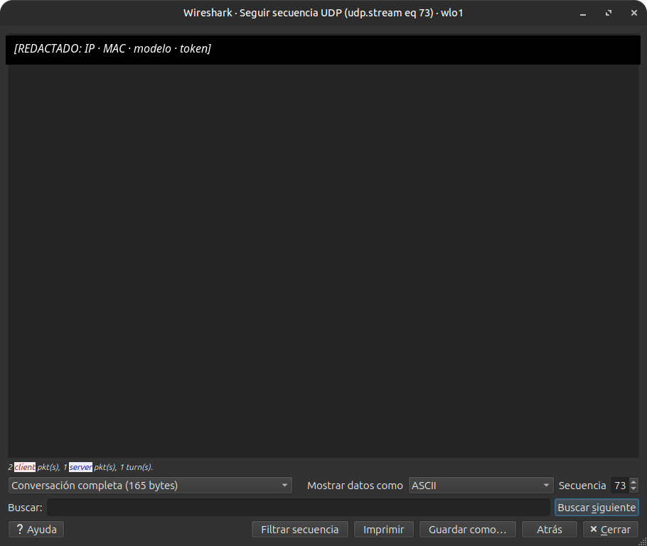
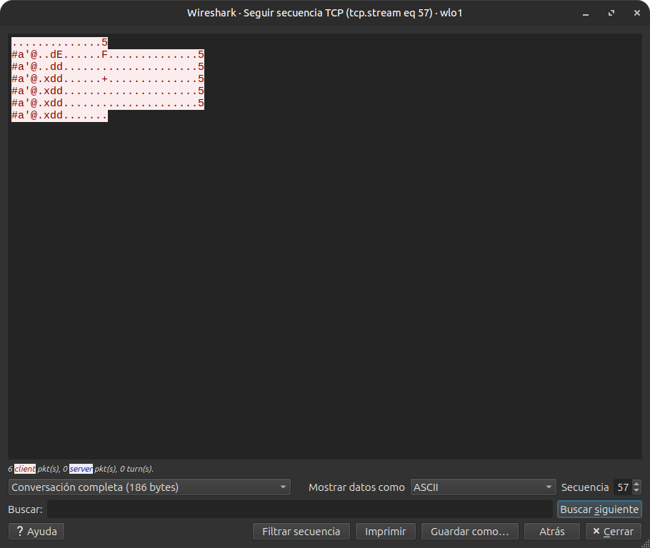
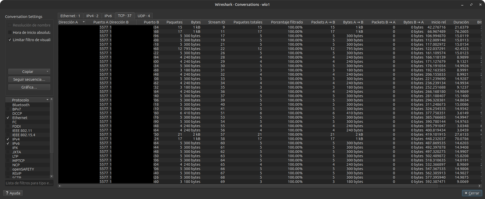
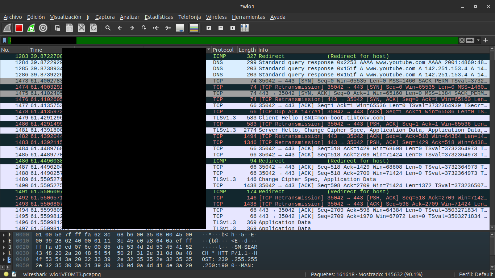
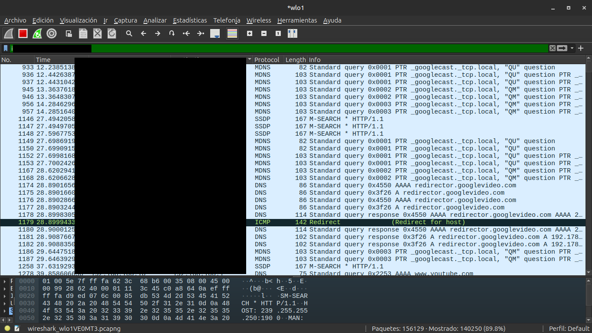
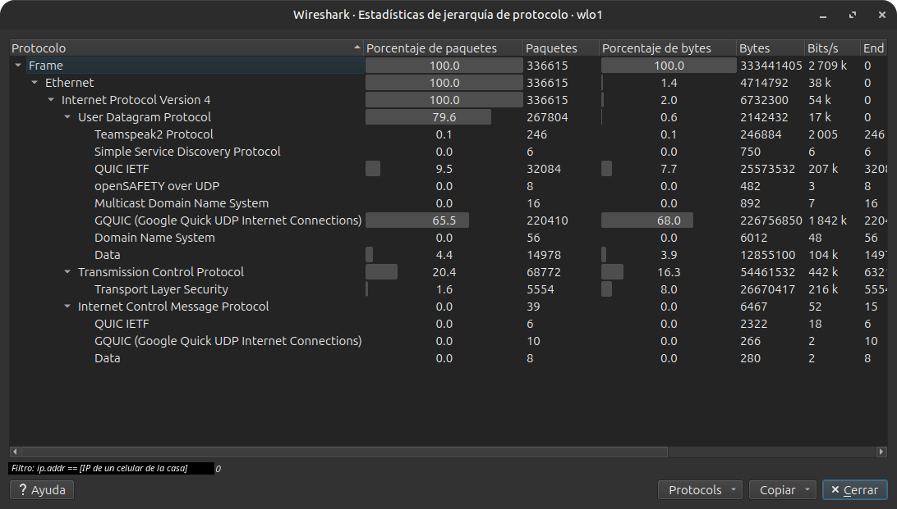

# Informe de auditoría — Análisis de seguridad en una red doméstica

**Autora:** Arely Muñoz, estudiante de ciberseguridad
**Tipo de proyecto:** auditoría académica, autorizada por escrito por los dueños de los dispositivos
**Alcance temporal:** julio–agosto de 2026

> ⚠️ **Nota de divulgación responsable.** Este informe describe una vulnerabilidad real encontrada en un dispositivo IoT de bajo costo ampliamente disponible en el mercado (focos/enchufes inteligentes "genéricos" controlados por app). **Deliberadamente no se publica la marca ni el modelo exacto del dispositivo**, ni el código de explotación completo y funcional. Ver [`exploit/README.md`](../exploit/README.md) para el detalle de qué se omitió y por qué. Todas las direcciones IP, direcciones MAC, nombres de red (SSID) y nombres de host reales fueron eliminados o sustituidos por marcadores genéricos.

---

## 1. Resumen ejecutivo

Audité la red Wi-Fi de mi casa como proyecto académico, con autorización familiar explícita y por escrito (ver [`alcance-y-autorizacion.md`](./alcance-y-autorizacion.md)). El objetivo inicial era puramente de descubrimiento pasivo: identificar qué dispositivos hay en la red y si alguno expone tráfico en texto plano. Durante la ejecución, el alcance creció de forma autorizada hasta incluir interceptación activa (ARP spoofing) cuando el escaneo de puertos no bastó para identificar el protocolo de un dispositivo IoT.

**Hallazgo central:** una familia de focos/enchufes inteligentes de la casa expone un canal de control (TCP, puerto de la familia "Magic Home"/`flux_led`) **sin ninguna autenticación real** y **sin protección contra ataques de repetición (replay)**. Construí a mano un paquete válido con la estructura de protocolo reconstruida por ingeniería inversa y lo envié directo al dispositivo, sin necesidad de interceptar nada en el momento del ataque — el dispositivo obedeció. El mismo paquete, capturado una sola vez, sirve para controlar el dispositivo indefinidamente.

**Severidad:** media-alta a nivel LAN doméstica. No es explotable desde internet (el canal es local), pero cualquier dispositivo ya presente en la red Wi-Fi de la casa —incluyendo un invitado, un dispositivo IoT comprometido, o un atacante que ya rompió el Wi-Fi— puede controlar el dispositivo sin autorización, sin conocer ninguna contraseña, y sin dejar el rastro que dejaría un ataque activo de interceptación.

**No se encontraron** fugas de contenido en tráfico cifrado (HTTPS/TLS) de ningún dispositivo. Sí se confirmó, como es esperable, que los metadatos (dominio consultado por DNS, SNI de TLS, volumen y duración de la conexión) quedan visibles incluso cuando el contenido está cifrado.

---

## 2. Objetivos

- Descubrir y clasificar los dispositivos activos en la red doméstica.
- Identificar tráfico en texto plano y metadatos expuestos, usando herramientas estándar de línea de comandos (Nmap, Wireshark, TShark).
- Cuando el fingerprinting de puertos no bastara para identificar el protocolo de un dispositivo IoT, interceptar de forma autorizada su tráfico (ARP spoofing) para reconstruir el protocolo por ingeniería inversa.
- Validar cualquier hallazgo con una prueba de concepto reproducible, no quedarse en especulación.
- Diseñar una mitigación concreta a partir de las vulnerabilidades confirmadas.

## 3. Entorno y alcance

| Componente | Detalle |
|---|---|
| Sistema operativo del equipo auditor | Linux (host, sin máquina virtual) |
| Herramientas | Wireshark + `dumpcap` (con capabilities `cap_net_admin`/`cap_net_raw`, sin ejecutar todo con `sudo`), Nmap, TShark, `arpspoof` (paquete `dsniff`), Python 3 (`socket`) |
| Red auditada | Red Wi-Fi principal de la casa (2.4G y 5G, mismo segmento IPv4 /24) |
| Fuera de alcance | Subred de un repetidor de un segundo proveedor de servicios (tiene su propio NAT, segmento totalmente distinto) — decisión consciente de no ampliar el proyecto a esa red |
| Dispositivos de terceros | Se interceptó, con autorización previa, el tráfico de dispositivos de familiares (no solo el propio), limitado a observación de metadatos cuando el objetivo no era el propio equipo del auditor |

Decidí quedarme en el sistema anfitrión (sin VM) porque ARP spoofing necesita acceso crudo al adaptador Wi-Fi, y el modo "bridged" de una máquina virtual sobre un adaptador Wi-Fi es notoriamente poco confiable por limitaciones del propio estándar 802.11, no por mala configuración.

## 4. Metodología (resumen)

Ver el detalle completo, con comandos y explicación de cada paso, en [`02-metodologia.md`](./02-metodologia.md). En resumen:

1. **Descubrimiento de activos** con `nmap -sn` sobre el rango completo de la red.
2. **Clasificación de hosts** usando la MAC (vendor OUI + bit universal/local para distinguir MAC de fábrica de MAC aleatoria de privacidad), no la IP (que cambia por DHCP).
3. **Fingerprinting de puertos** (`nmap -sS -sV -p-`) en los hosts no identificables solo por MAC/vendor.
4. **Captura de tráfico** con Wireshark, filtrando por protocolo (HTTP, DNS, TLS/SNI, mDNS, ARP).
5. **Interceptación activa autorizada (ARP spoofing)** cuando el fingerprinting de puertos no identificó el protocolo de un dispositivo IoT.
6. **Ingeniería inversa del protocolo** encontrado: formato de trama, campos, fórmula de checksum.
7. **Prueba de concepto**: construcción manual de un paquete válido y envío directo al dispositivo, para confirmar que el hallazgo es explotable y no solo teórico.
8. **Diseño de mitigación** a partir de las debilidades confirmadas.

## 5. Resultados y hallazgos

### 5.1 Descubrimiento y clasificación de activos

El escaneo de descubrimiento (`nmap -sn`) sobre la red completa devolvió entre 19 y 20 hosts activos en corridas distintas. Varios dispositivos cambiaban de IP entre una corrida y otra (DHCP), así que dejé de usar la IP como identificador y me ancle a la MAC.

Para separar celulares con MAC aleatoria (randomización por privacidad, estándar en iOS/Android modernos) de hardware real de fábrica, calculé el **bit universal/local (U/L)**: el segundo bit menos significativo del primer octeto de la MAC. En 1 → MAC generada por software (típico de un celular con randomización activa). En 0 → MAC de fábrica real, asignada por el fabricante.

Clasificación resultante (identificadores generalizados):

| Rol | Cantidad aprox. | Clasificación |
|---|---|---|
| Router/gateway principal | 1 | Infraestructura, no es objetivo |
| Decodificador/repetidor de un segundo proveedor | 1 | Confirmado, no es objetivo |
| Consola de videojuegos | 1 | Confirmado (hardware de fábrica, firewall propio cerrado a todo) |
| Altavoces inteligentes / streaming de TV | 4 | Investigados, sin hallazgo explotable (ver abajo) |
| Smart TV | 1 | Investigada, sin puertos abiertos |
| Focos/enchufes inteligentes | 7 (dos familias de firmware distintas) | Objetivo principal — una familia resultó vulnerable |
| Celulares de la casa | el resto | Descartados (MAC aleatoria confirmada) |

### 5.2 Fingerprinting de puertos — hallazgos por categoría

**Decodificador/repetidor de un segundo proveedor.** Un puerto respondía con una cabecera de SDK típica de chips de una familia de silicio usada en cámaras IP, DVRs baratos y decodificadores de TV por cable; otro puerto respondía con la certificación estándar de plataformas de streaming para smart TVs/set-top boxes. El puerto que usan las cámaras IP (RTSP) **no estaba abierto**, lo que descartó mi hipótesis inicial de que fuera una cámara.

**Consola de videojuegos.** Los 65 535 puertos salieron en estado "filtrado" (sin ninguna respuesta). MAC de fábrica real, sin hostname personalizado en el panel del router, patrón de conexión intermitente sin horario fijo de persona — consistente con un dispositivo que se apaga cuando no está en uso.

**Altavoces inteligentes / streaming de TV.** Los cuatro dispositivos mostraron el mismo patrón: dos puertos identificados por Nmap como un protocolo de monitoreo pasivo de servidores. Concluí que es casi con certeza un **falso positivo de fingerprinting**: ese protocolo asume un rol de servidor que recibe reportes, mientras que estos dispositivos son clientes que le reportan a la nube del fabricante — el rol no coincide con la función real del dispositivo. También se encontró un puerto marcado como proxy SOCKS5 "sin autenticación" en tres de los cuatro; lo probé intentando túneles reales hacia un dominio genérico y hacia el dominio del propio fabricante, y en ambos casos el servicio **rechazó la conexión de forma activa e inmediata** — no es un proxy abierto funcional, descartado como hallazgo explotable. Uno de los cuatro dispositivos se confirmó explícitamente, por fingerprint directo de Nmap, como un reproductor de streaming de un fabricante conocido.

**Smart TV.** Ningún puerto abierto, los 65 535 salieron "filtrado". Mi hipótesis inicial ("las marcas grandes invierten más en seguridad") no se sostuvo al comparar contra los altavoces/streaming (de un fabricante todavía más grande, con más superficie expuesta); lo que parece importar es el tipo de función que el dispositivo necesita exponer en la red local, no el tamaño de la empresa. Con una sola Smart TV en la muestra tampoco se puede generalizar esta observación a toda la categoría.

**Focos/enchufes inteligentes.** Dos familias de firmware distintas, con puertos de control propios. Nmap no logró identificar el protocolo real detrás de ninguno de los dos puertos propietarios — "servicio desconocido" en ambos casos — lo que motivó pasar a inspección directa de tráfico.

### 5.3 ARP spoofing: metodología y problemas reales de ejecución

En un switch normal, un equipo solo ve su propio tráfico unicast más lo que sea broadcast/multicast (ARP, DHCP, mDNS). Para ver la conversación entre un celular y un foco (ninguno de los dos es mi equipo), hacía falta ponerme en medio con ARP spoofing: envenenar la caché ARP del celular (haciéndome pasar por el foco) y la del foco (haciéndome pasar por el celular), con reenvío de IP activado para no cortar el tráfico.

El primer experimento lo hice con mi propio celular y mi propio foco, para no arriesgar el dispositivo de nadie más mientras aprendía la herramienta. No salió a la primera, y documentar **por qué** no salió terminó siendo tan valioso como el resultado:

- **Un error de tipeo en una IP** dejó una de las dos direcciones del ataque sin envenenar — until until, en vez de un fallo catastrófico, el resultado fue una intercepción parcial (solo una dirección de la conversación), lo que confirmó que las dos instancias del envenenamiento ARP son ataques independientes, uno por sentido.
- **Un bug de restauración de `arpspoof`**: al detener el ataque con Ctrl+C en cierto estado, la herramienta restauró la caché ARP de las víctimas apuntando a una dirección MAC de todos ceros en vez de la MAC real, dejando temporalmente sin conexión al dispositivo. En un reintento limpio, la restauración sí usó la MAC real.
- **Intercepción unidireccional persistente:** con las dos direcciones del ataque bien configuradas, capturé 37 conversaciones TCP en el puerto del protocolo propietario, pero **las 37 tenían datos en un solo sentido** (dispositivo→celular, nunca celular→dispositivo). La hipótesis inicial fue que el celular refrescaba su caché ARP más rápido de lo que el ataque lograba re-envenenarla.

Esa hipótesis se cayó en la sesión siguiente: al repetir el ataque, la app del dispositivo marcó "sin conexión a internet" solo para ese dispositivo. Descarté paso a paso, con evidencia y no por intuición: el control por voz (vía nube) seguía funcionando → el dispositivo no había perdido su internet real; un ping desde el celular con el ataque activo tuvo 0% de pérdida → el reenvío IP básico sí funcionaba; una consulta directa al protocolo de descubrimiento del dispositivo (ver §5.4) **no obtuvo respuesta** con el ataque activo. Revisando la captura, el paquete sí llegaba a mi equipo, pero mi equipo nunca lo reenviaba hacia el dispositivo.

**Causa raíz:** `sudo iptables -L FORWARD -n -v` reveló que la cadena `FORWARD` tenía política por defecto **DROP**, con cientos de paquetes ya descartados — una regla del firewall del propio sistema operativo (activo por defecto), con una única excepción explícita para ping. Esto explica retroactivamente tanto el "sin internet" como la intercepción unidireccional de la sesión anterior: nunca fue el celular "ganando una carrera" contra el ataque, era mi propio firewall bloqueando en silencio ese sentido del tráfico desde el principio. Corregido con una regla explícita que permite el reenvío entre dispositivos de la misma interfaz, sin desactivar el firewall completo.

**Lección de metodología:** al hacer MITM local desde un equipo de uso diario (no una máquina dedicada de pruebas), el propio equipo atacante puede tener configuración que interfiera con el ataque sin dar ningún error visible. Vale la pena revisar el propio entorno antes de asumir que el problema está del lado de la víctima.

Un efecto secundario identificado y mitigado: el equipo, al reenviar un paquete de vuelta por la misma interfaz por la que llegó, generaba automáticamente paquetes ICMP Redirect — si la víctima les hace caso, aprende a saltarse al atacante y el ataque se rompe. Se desactivó explícitamente ese comportamiento del kernel para la interfaz usada.

### 5.4 Hallazgo central: ingeniería inversa del protocolo de control del dispositivo IoT



*El dispositivo responde a una frase mágica fija y públicamente documentada, por UDP, con su IP, su MAC, su modelo de hardware exacto y un token hexadecimal — todo en texto plano. Los valores reales se redactaron para esta publicación.*

Antes de llegar al canal de control, encontré un servicio de descubrimiento (puerto UDP de la familia de protocolo) que responde a una **frase de consulta fija, pública y documentada en internet** con la IP, la MAC, el modelo exacto de hardware y un token hexadecimal del dispositivo, **todo en texto plano, sin ninguna autenticación**. Confirmé que ni siquiera hace falta ARP spoofing para obtener esta respuesta: cualquier equipo de la LAN que conozca la frase puede pedir esta información a cualquier dispositivo de esta familia.

El canal de control real está en un puerto TCP dedicado. Con capturas ya limpias (sin el problema del firewall), reconstruí el formato completo de la trama comparando paquetes de distinto tamaño:

```
MAGIC (4 bytes) | TIPO (2 bytes) | CONTADOR (2 bytes) | LARGO (2 bytes) | DATOS (LARGO bytes) | CHECKSUM (1 byte)
```

- **MAGIC:** constante en el 100% de los paquetes capturados, sin importar el emisor. Es un identificador de protocolo público, no una credencial — no distingue a un emisor autorizado de uno falsificado.
- **TIPO:** indica si el mensaje va del cliente (app/celular) al dispositivo o al revés.
- **CONTADOR:** sube de uno en uno en tráfico normal, aparentemente global (no reinicia entre conexiones nuevas).
- **LARGO:** indica cuántos bytes siguen en la sección de datos, donde vive el comando real.
- **CHECKSUM:** descubierto por el método más simple posible — probé primero XOR (no cuadró), luego suma de todos los bytes del mensaje módulo 256 (sí cuadró, verificado en varios paquetes independientes). Es un checksum aditivo simple para detectar errores de transmisión, **no criptográfico**: cualquiera que conozca la fórmula (que no es ningún secreto) puede calcularlo.



*Volcado ASCII de uno de los flujos TCP capturados — se aprecia el patrón repetitivo propio de un protocolo binario sin cifrar.*

Con un experimento controlado (una sola acción por captura: encender o apagar), identifiqué el payload de 3 bytes correspondiente al comando de apagar por presencia/ausencia consistente en las muestras correspondientes.

### 5.5 Prueba de concepto: control sin autenticación y vulnerabilidad de repetición (replay)

Con el formato y la fórmula del checksum ya confirmados, escribí un script corto en Python (`socket`) que arma un paquete válido a mano y lo manda directo al dispositivo — **sin ningún ARP spoofing activo**, conexión TCP directa. El dispositivo ejecutó el comando. Lo confirmé viendo salir el paquete real en Wireshark, con el payload idéntico byte por byte.

Después probé algo más: mandé el mismo tipo de comando pero con valores de **CONTADOR completamente distintos a la secuencia real** — uno alto arbitrario, y uno bajo que ya había usado en una captura de una sesión muy anterior. **El dispositivo obedeció en ambos casos.** Esto confirma que, además de no tener autenticación, el protocolo tampoco protege contra ataques de repetición: un paquete capturado una sola vez sirve para controlar el dispositivo indefinidamente, sin importar cuánto tiempo haya pasado.



*Vista de Estadísticas → Conversaciones de Wireshark usada para diagnosticar el problema de intercepción unidireccional descrito en §5.3 — confirma que las 37 conversaciones capturadas en ese momento tenían datos en un solo sentido.*

**Esto convierte el hallazgo de "riesgo hipotético" a exploit funcional y reproducible:** cualquier dispositivo en la misma red LAN puede controlar el dispositivo sin ser la app oficial, sin interceptar nada en el momento del ataque, y sin conocer ningún secreto real, porque el único mecanismo de verificación (el checksum) es una fórmula pública y el contador no se valida.

### 5.6 Observación autorizada de tráfico de terceros (metadatos)

Con autorización familiar explícita (ver §1 del documento de alcance), repetí el ARP spoofing sobre el celular de un familiar en uso cotidiano normal, con el único objetivo de buscar protocolos en texto plano — no de controlar nada.



*Aunque el contenido de la conexión HTTPS está cifrado, el nombre de dominio en el campo SNI del primer paquete de la conexión (Client Hello) viaja sin cifrar.*

- **Cero paquetes HTTP** en toda la sesión capturada — las apps usadas cifran correctamente su tráfico de contenido. Resultado negativo válido.
- **DNS en claro** reveló los dominios que se estaban resolviendo, y el **SNI del Client Hello de TLS** (el primer paquete de cualquier conexión HTTPS) reveló el dominio sin cifrar, aunque el resto de la conexión sí estuviera protegido.
- **mDNS** mostró al celular buscando activamente dispositivos de streaming en la red local (`_googlecast._tcp.local`), lo que conecta con el puerto de Google Cast ya visto abierto en uno de los dispositivos de streaming (§5.2).



Con Estadísticas → Jerarquía de protocolos sobre una captura de más de 330 mil paquetes, casi todo el tráfico real iba sobre el transporte cifrado que usa una plataforma de video conocida. Aparecieron también dos entradas con nombres de protocolos antiguos/poco comunes, ambas con muy pocos paquetes del total — en los dos casos resultaron ser **falsos positivos del propio disector de Wireshark** (coincidencia de bytes con la huella de protocolos no relacionados), confirmados siguiendo el flujo correspondiente y encontrando texto legible de un servicio de video conocido.



**Conclusión de esta sección:** sin romper ningún cifrado, se puede saber con bastante precisión qué servicios usa un dispositivo en tiempo real, solo con metadatos. Es el equivalente a ver un recibo telefónico (a quién se llamó y cuánto duró) en vez de escuchar la llamada.

## 6. Severidad y análisis de riesgo

| Hallazgo | Requiere interceptar tráfico | Requiere secreto/credencial | Alcance del daño |
|---|---|---|---|
| Descubrimiento del dispositivo IoT (modelo, MAC, token) en texto plano | No | No (frase pública) | Reconocimiento — facilita buscar vulnerabilidades conocidas para ese hardware |
| Control del dispositivo IoT sin autenticación | No | No | Control no autorizado del dispositivo por cualquier equipo en la misma LAN |
| Repetición (replay) de un comando capturado una sola vez | Solo una vez, para capturarlo | No | El mismo efecto que el punto anterior, pero sin necesitar entender el protocolo en el momento del ataque |
| Metadatos visibles en tráfico cifrado (DNS/SNI) | Sí (o solo observación pasiva de broadcast) | No | Perfil de uso (qué servicios, cuándo, cuánto), nunca el contenido |

No se intentó buscar si existe ya un CVE público para esta familia de hardware; se deja como recomendación de seguimiento (ver mitigaciones).

## 7. Conclusiones

El hallazgo más fuerte de esta auditoría no estuvo en las apps grandes ni en los dispositivos de marcas conocidas, sino en el IoT barato de la casa — exactamente donde se esperaba encontrarlo desde el planteamiento inicial del proyecto. El canal de control de ese dispositivo resultó completamente abierto: sin autenticación real y sin protección contra repetición, algo comprobado de forma reproducible y no solo teórica.

Buena parte del tiempo del proyecto no se fue en el ataque en sí, sino en depurar por qué el ataque no se comportaba como debería (un error de tipeo, un bug de restauración de ARP, y sobre todo el propio firewall del equipo atacante bloqueando tráfico en silencio). La lección de metodología más reutilizable: no asumir que un problema está del lado del objetivo sin antes revisar el propio equipo, y no dar por buena la primera explicación sin verificarla con evidencia — varios "hallazgos" de herramientas de fingerprinting automatizado (Nmap y el propio disector de Wireshark) resultaron ser falsos positivos, no vulnerabilidades reales.

Ver [`03-mitigaciones.md`](./03-mitigaciones.md) para el rediseño propuesto del protocolo y recomendaciones generales de segmentación de red.
